

### How I Build Products

> I focus on turning real-world problems into reliable, scalable and maintainable software through thoughtful engineering and continuous improvement.

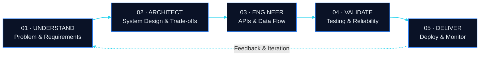
### Featured Projects

<!-- Project names stay on the left; expandable project content stays on the right. -->
<table width="100%">
  <thead>
    <tr><th align="left" width="34%">Project</th><th align="left" width="66%">Project Details</th></tr>
  </thead>
  <tbody>
    <tr>
      <td width="34%" valign="top"><strong>01 · Orderly — Real-Time Food Delivery Platform</strong></td>
      <td width="66%" valign="top">

  

   
<table width="100%">
  <tr>
    <td width="50%" align="center" valign="middle">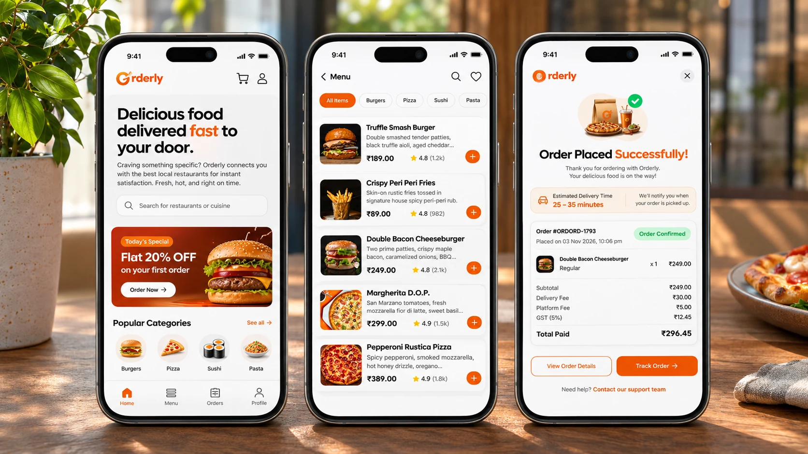</td>
    <td width="50%" align="center" valign="middle">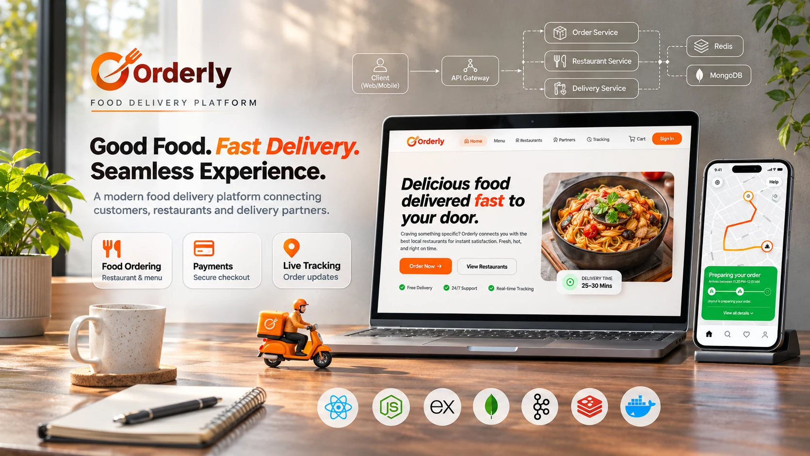</td>
  </tr>
</table>

   Real-time food delivery platform connecting customers, restaurants, and delivery partners. Focuses on domain-focused services, order workflows, Kafka-based event communication, and realtime updates.

  
<strong>Tech Stack</strong>        

  
<a href="https://github.com/rajesh-kayal-dev/orderly">GitHub</a> · <a href="https://orderly-puce-rho.vercel.app/">Live</a> · <a href="https://github.com/rajesh-kayal-dev/orderly/tree/9ddfd1df8b31df2fc2f3c941a005e31d60da77a8/docs">Docs</a>

</td>
    </tr>
    <tr>
      <td width="34%" valign="top"><strong>02 · Drawzware — System Design &amp; Architecture Diagramming</strong></td>
      <td width="66%" valign="top">

  

   
<table width="100%">
  <tr>
    <td width="50%" align="center" valign="middle">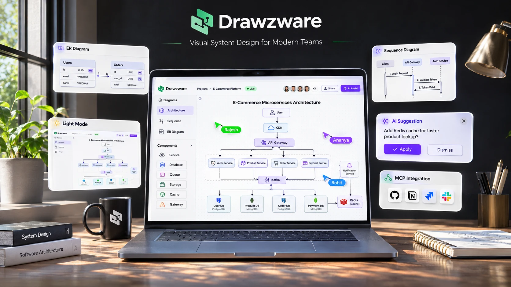</td>
    <td width="50%" align="center" valign="middle">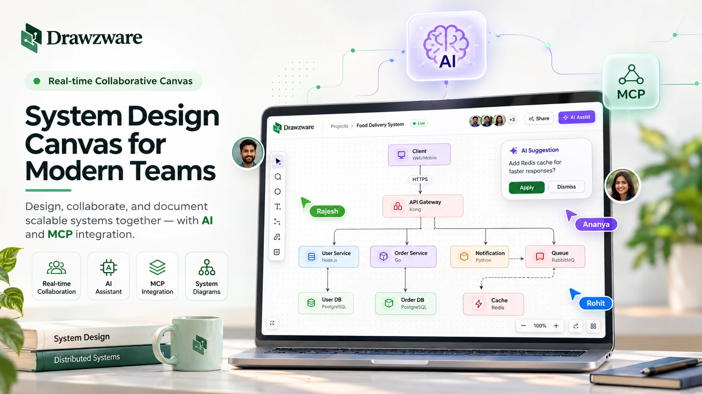</td>
  </tr>
</table>

   Modern visual system-design workspace for creating architecture, sequence, and ER diagrams. Supports structured diagramming and collaborative system-design workflows.

  
<strong>Tech Stack</strong>        

  
<a href="https://github.com/rajesh-kayal-dev/Drawzware">GitHub</a> · <a href="https://drawzware.vercel.app/">Live</a> · <a href="https://github.com/rajesh-kayal-dev/Drawzware/tree/5799e456c3b518b54f11b8e094c86b7e9906d920/docs">Docs</a>

</td>
    </tr>
    <tr>
      <td width="34%" valign="top"><strong>03 · Calby — Personal Desktop Assistant</strong></td>
      <td width="66%" valign="top">

  

   
<table width="100%">
  <tr>
    <td width="50%" align="center" valign="middle">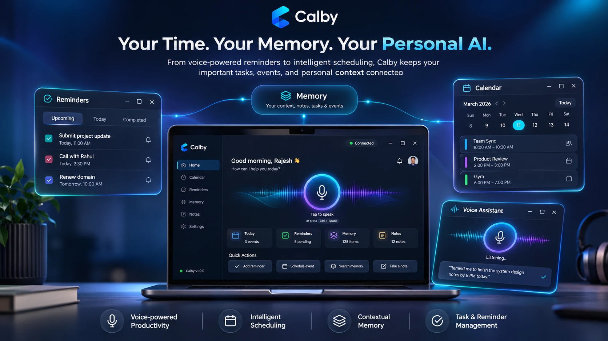</td>
    <td width="50%" align="center" valign="middle">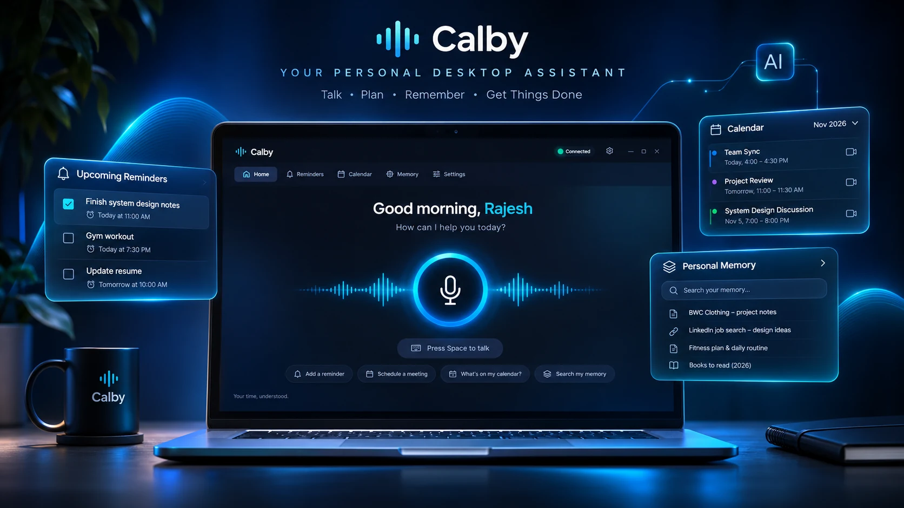</td>
  </tr>
</table>

   Personal desktop assistant for voice-powered interactions, reminders, calendar scheduling, and contextual personal memory. Runs as a desktop application and connects everyday tasks in one place.

  
<strong>Tech Stack</strong>       

  
<a href="https://github.com/rajesh-kayal-dev/calby-desktop">GitHub</a> · <a href="https://calby-mu.vercel.app/">Live</a> · <a href="https://github.com/rajesh-kayal-dev/calby-desktop/tree/7a26e711c8b06f0f6ed215a22f454c872f9c3d6a/docs">Docs</a>

</td>
    </tr>
    <tr>
      <td width="34%" valign="top"><strong>04 · CanIClone — AI-Assisted Product Research &amp; MVP Planning</strong></td>
      <td width="66%" valign="top">

  

   
<table width="100%">
  <tr>
    <td width="50%" align="center" valign="middle">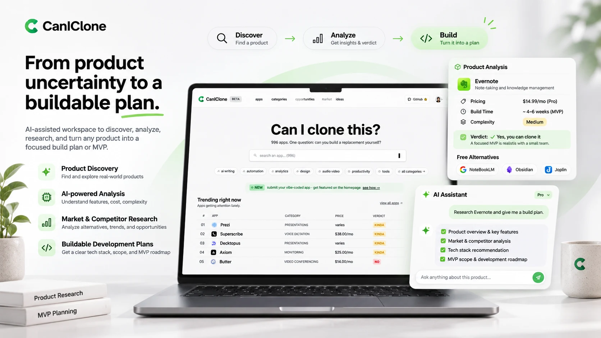</td>
    <td width="50%" align="center" valign="middle">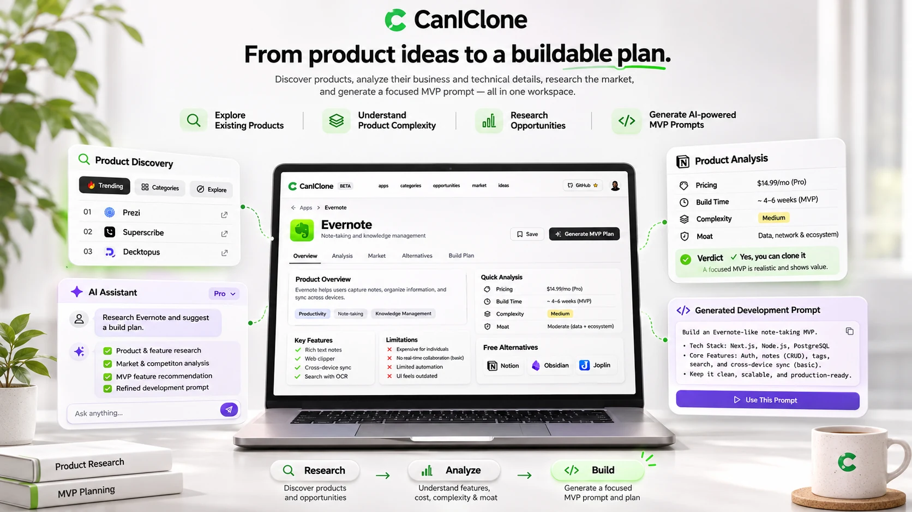</td>
  </tr>
</table>

   AI-assisted development workspace for exploring products, understanding features and complexity, researching alternatives, and turning product context into focused prompts and MVP specifications.

  
<strong>Tech Stack</strong>         

  
<a href="https://github.com/rajesh-kayal-dev/CanIClone">GitHub</a> · <a href="https://caniclone.vercel.app/">Live</a> · <a href="https://github.com/rajesh-kayal-dev/CanIClone/tree/main/docs">Docs</a>

</td>
    </tr>
    <tr>
      <td width="34%" valign="top"><strong>05 · BWC Clothing — E-Commerce Store</strong></td>
      <td width="66%" valign="top">

  

   
<table width="100%">
  <tr>
    <td width="50%" align="center" valign="middle">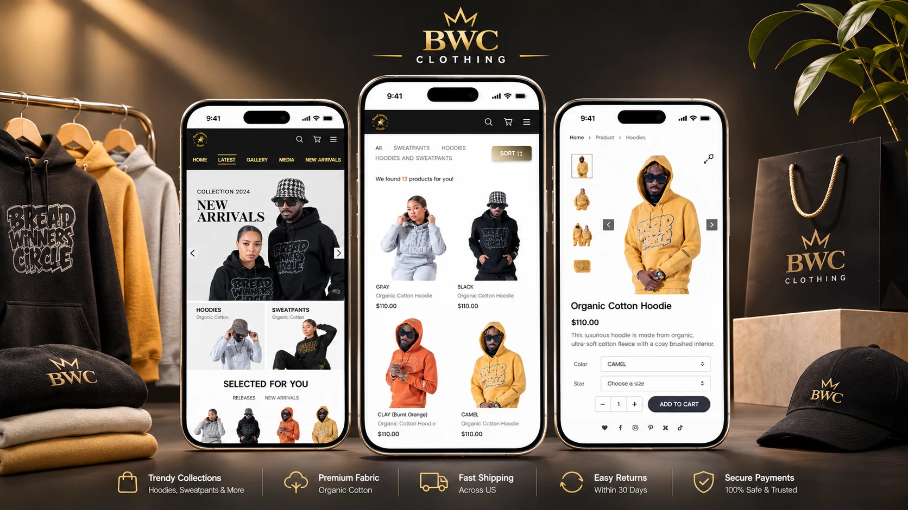</td>
    <td width="50%" align="center" valign="middle">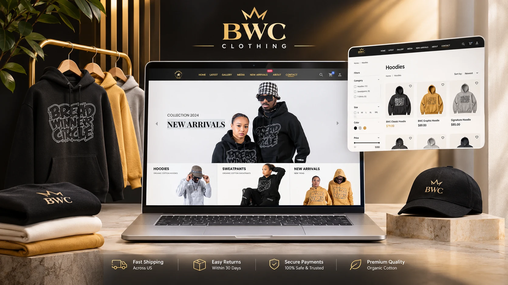</td>
  </tr>
</table>

   E-commerce website for an online clothing store, featuring user authentication, product browsing, shopping cart, wishlist, secure payment integration, and an admin dashboard.

  
<strong>Tech Stack</strong>     

  
<a href="https://github.com/rajesh-kayal-dev/bwcclothing">GitHub</a> · <a href="https://bwcclothing.com/">Live</a>

</td>
    </tr>
    <tr>
      <td width="34%" valign="top"><strong>06 · Inwood Pizza — Local Pizzeria &amp; Online Ordering Website</strong></td>
      <td width="66%" valign="top">

  

   
<table width="100%">
  <tr>
    <td width="50%" align="center" valign="middle">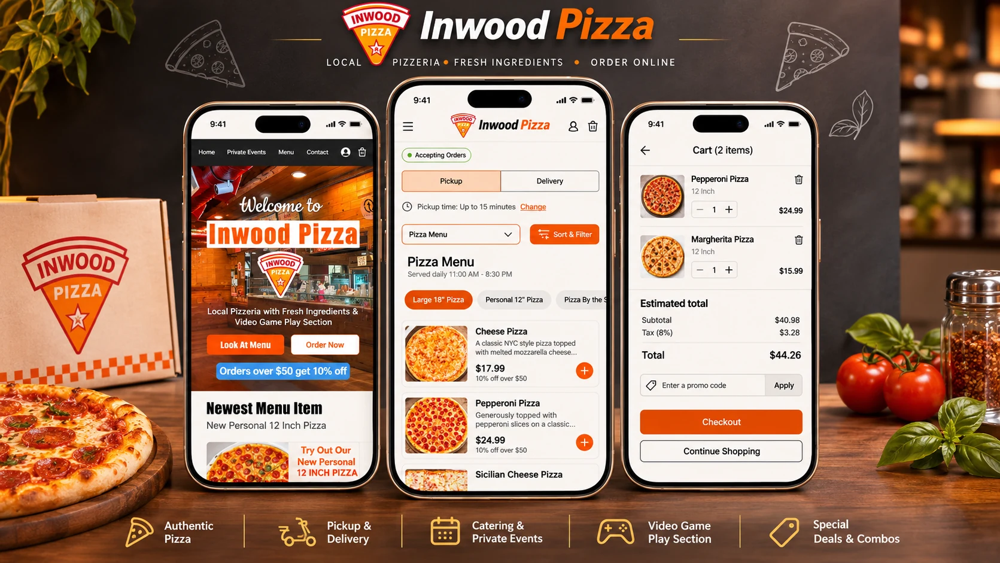</td>
    <td width="50%" align="center" valign="middle">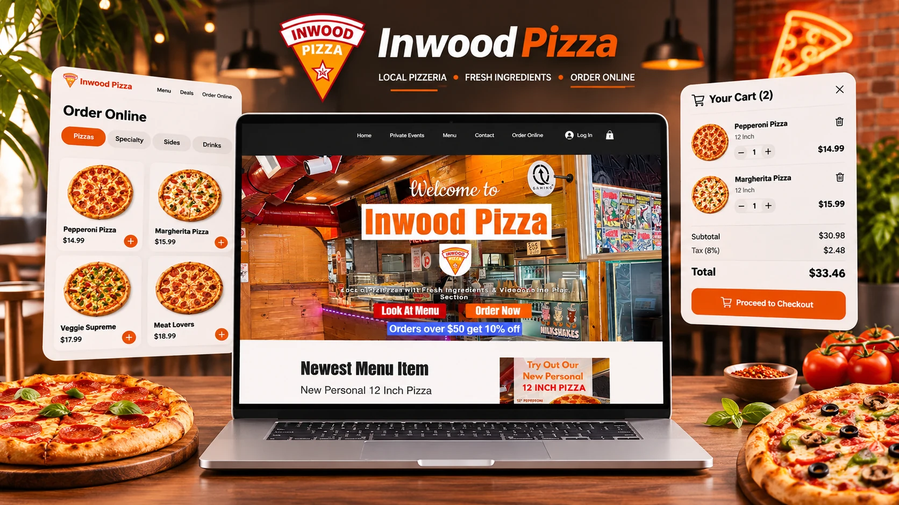</td>
  </tr>
</table>

   Local pizzeria website and ordering experience for fresh pizza, online orders, private events, and catering. The supplied visual references show mobile ordering flows and the desktop website.

  
<strong>Tech Stack</strong>     

  
<a href="https://www.inwoodpizzanyc.com/">Live</a> · <em>GitHub and Docs are private</em>

</td>
    </tr>
  </tbody>
</table>

### Engineering Toolkit

<a href="https://wndcd2ip52f5g.kimi.page/" target="_blank">
  
</a>

### Let's Connect

<<<<<<< HEAD

=======

# Introduction

Most users only see a button. I love building what happens after they click it.

That curiosity turned me into a **Full Stack Developer** with 1+ year of experience. I build fast, secure and scalable products that go live and are built to handle real users.

My main stack is **React, Node.js, TypeScript, PostgreSQL, Kafka, Docker and AWS**, with a focus on **Cloud & DevOps** and hands-on experience in **microservices architecture**.

I enjoy turning complex problems into simple, clean systems that can grow with the product. Always open to connect and build impactful products.

### Technology Stack

**Languages** &nbsp;

**Frontend** &nbsp;

**Backend** &nbsp;

**Databases** &nbsp;

**Cloud & DevOps** &nbsp;

**AI** &nbsp;

### GitHub Stats

>>>>>>> db3e8eaa0537213d9352e9530720e7968fd22cb1
