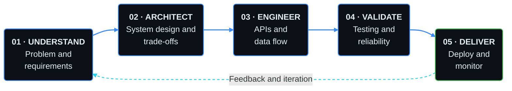

### How I Build Products

Turning real-world problems into reliable, scalable and maintainable software.

<h3 align="left">Featured Projects</h3>

<strong>01 · Orderly</strong> — Real-Time Food Delivery Platform

 

  
  

Real-time food delivery platform connecting customers, restaurants, and delivery partners. Focuses on domain-focused services, order workflows, Kafka-based event communication, and realtime updates.

<strong>Tech Stack</strong>        

  

<strong>02 · Drawzware</strong> — System Design &amp; Architecture Diagramming

 

  
  

Modern visual system-design workspace for creating architecture, sequence, and ER diagrams. Supports structured diagramming and collaborative system-design workflows.

<strong>Tech Stack</strong>        

  

<strong>03 · Calby</strong> — Personal Desktop Assistant

 

  
  

Personal desktop assistant for voice-powered interactions, reminders, calendar scheduling, and contextual personal memory. Runs as a desktop application and connects everyday tasks in one place.

<strong>Tech Stack</strong>       

  

<strong>04 · CanIClone</strong> — AI-Assisted Product Research &amp; MVP Planning

 

  
  

AI-assisted development workspace for exploring products, understanding features and complexity, researching alternatives, and turning product context into focused prompts and MVP specifications.

<strong>Tech Stack</strong>         

  

<strong>05 · BWC Clothing</strong> — E-Commerce Store

 

  
  

E-commerce website for an online clothing store, featuring user authentication, product browsing, shopping cart, wishlist, secure payment integration, and an admin dashboard.

<strong>Tech Stack</strong>     

 

<strong>06 · Inwood Pizza</strong> — Local Pizzeria &amp; Online Ordering Website

 

  
  

Local pizzeria website and ordering experience for fresh pizza, online orders, private events, and catering. The supplied visual references show mobile ordering flows and the desktop website.

<strong>Tech Stack</strong>     

 &nbsp;<em>GitHub and Docs are private</em>

### Engineering Toolkit

### Let's Connect

